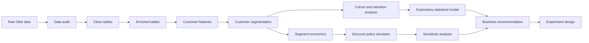
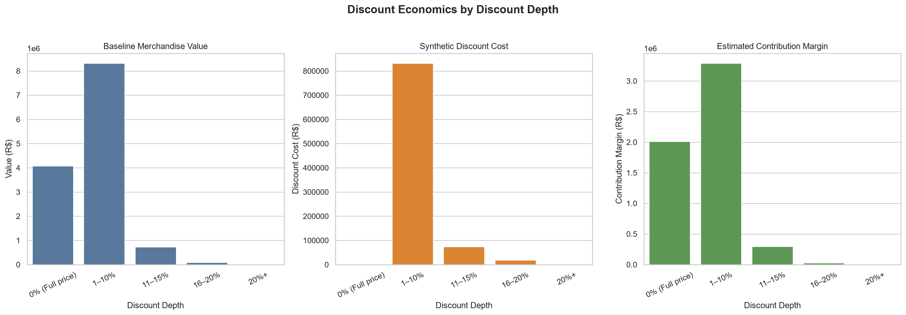
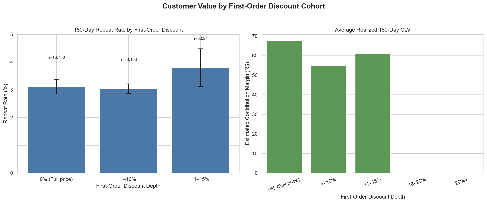
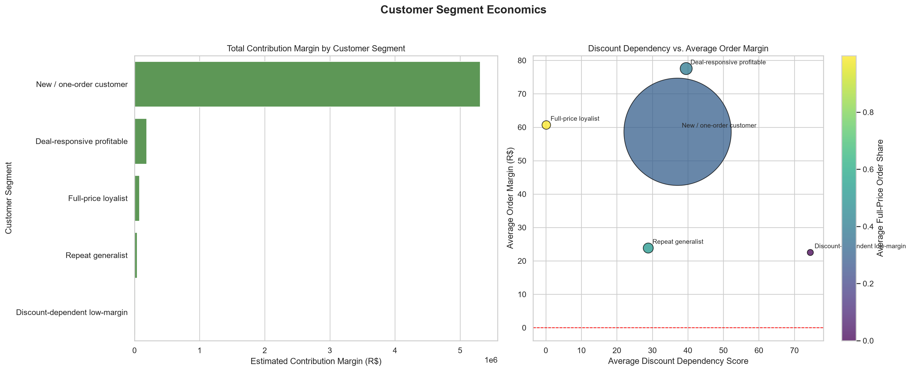
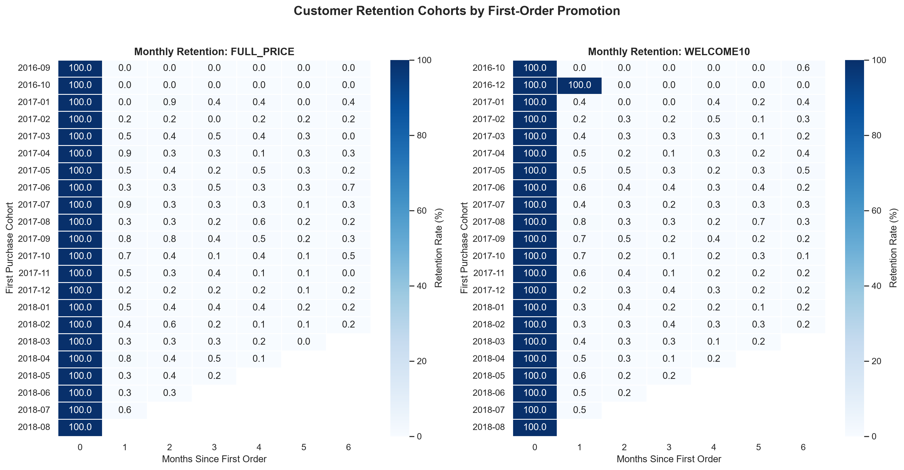
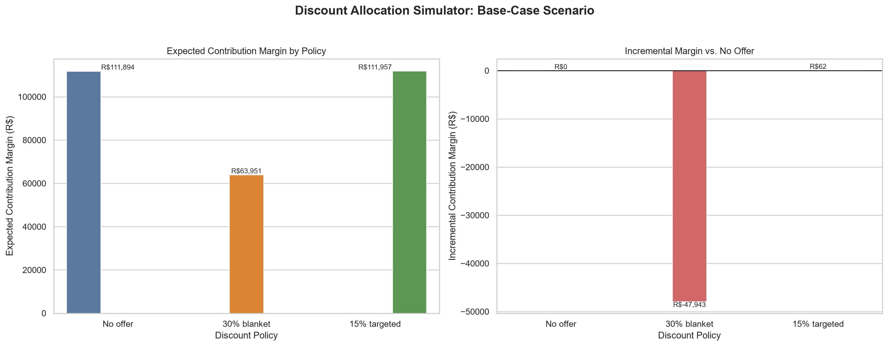
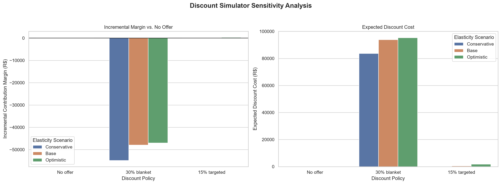

# The Discount Addiction Problem

**Do discounts create long-term customer value, or do they train customers to wait for the next markdown?**

This project uses the Olist Brazilian E-Commerce dataset to evaluate discount economics, customer behavior, retention, and targeted discount policies through descriptive analysis and an assumption-driven simulator.

## Business Problem

Blanket discounting can increase orders while reducing the contribution margin earned on each order. The important question is not whether a discount produces a purchase; it is whether the incremental customer value created by that discount exceeds the margin sacrificed to provide it.

This project treats discounting as a customer economics and experimentation problem. It examines which customers appear responsive to discounts, which customers may purchase without them, and whether a targeted policy looks more economically attractive than a blanket offer.

## Business Questions

- Which customers appear most responsive to discounts?
- Which customers are likely to purchase without discounts?
- Which customer segments generate attractive contribution margins?
- How do first-order discount bands compare on 180-day repeat behavior and realized CLV?
- What happens under no-offer, blanket, and targeted discount policies?
- Which policy appears economically preferable under the documented scenario assumptions?
- How should the recommendation be validated with a randomized experiment?

## Dataset

The project uses the public Olist Brazilian E-Commerce dataset. The raw files contain customers, orders, order items, payments, reviews, products, sellers, geolocation data, and category translations.

The raw data includes 99,441 orders, 112,650 order items, 103,886 payments, 99,224 reviews, 32,951 products, 3,095 sellers, 1,000,163 geolocation rows, and 71 category translations.

The primary customer analysis uses `customer_unique_id`, rather than the order-level `customer_id`. The delivered-order analysis contains 96,478 orders and 93,358 unique customers. Of those customers, 55,907 have a complete 180-day observation window.

### Observed data versus scenario fields

Olist does **not** contain historical promotion campaigns, observed discount assignments, list prices, true product costs, marketing exposure, or explicit return events. The project therefore distinguishes three types of information:

| Type | Meaning in this project |
| --- | --- |
| Observed | Historical Olist transaction, customer, product, payment, review, and logistics fields |
| Estimated | Financial fields derived from documented cost-rate assumptions, including product cost, payment fees, fulfillment costs, and contribution margin |
| Simulated | Promotion assignments, discount policies, demand response, and policy economics generated from explicit scenario assumptions |

Observed item `price` is reused as a simulated baseline list price. Estimated product cost rates are 45% for high-margin products, 60% for medium-margin products, and 75% for low-margin products. The project also uses a 3% estimated payment fee, fulfillment costs based on freight, and a fixed R$5 fulfillment cost per delivered order. Estimated return cost is currently R$0 because explicit returns are unavailable.

## Analytical Approach



The pipeline produces Parquet tables, a DuckDB analytical database, CSV summaries, model outputs, figures, and an executive summary draft.

## Executive Summary

The base-case simulator recommends `TARGETED15` over `BLANKET30` and `NO_OFFER` under its scenario assumptions:

| Policy | Customers offered | Expected orders | Expected discount cost | Expected contribution margin | Incremental margin vs. no offer |
| --- | ---: | ---: | ---: | ---: | ---: |
| `NO_OFFER` | 0 | 1,852.95 | R$0.00 | R$111,894.39 | R$0.00 |
| `BLANKET30` | 93,358 | 2,477.53 | R$93,852.19 | R$63,950.92 | -R$47,943.46 |
| `TARGETED15` | 115 | 1,863.58 | R$461.59 | R$111,956.62 | R$62.24 |

`TARGETED15` sends offers only to targetable segments and only where modeled incremental margin is positive. It produces a small positive base-case incremental margin, while the blanket policy produces substantially more expected orders but lower expected contribution margin than no offer.

These are **scenario results, not causal estimates**. They depend on estimated margins, segment-level elasticity assumptions, discount caps, modeled purchase probabilities, and historical behavior. They should be validated through the proposed randomized experiment before production use.

## Key Findings

1. The eligible customer population has a 3.11% observed 180-day repeat rate and average realized 180-day CLV of R$59.04.
2. The estimated total contribution margin is R$5,625,364.96; it is not observed Olist profit because product costs, payment fees, fulfillment costs, and returns are estimated or unavailable.
3. `BLANKET30` increases expected orders in the simulator but decreases expected contribution margin by R$47,943.46 versus `NO_OFFER`.
4. `TARGETED15` offers to 115 customers in the base case and produces modeled incremental contribution margin of R$62.24 versus no offer.
5. Sensitivity analysis keeps `BLANKET30` negative across conservative, base, and optimistic elasticity scenarios. `TARGETED15` ranges from +R$3.09 to +R$292.70.
6. Discount-dependent low-margin customers have the highest average dependency score, 74.50, but the lowest average order margin among repeat-oriented segments at R$22.52.
7. The first-order cohort comparisons and repeat-purchase model are descriptive and observational. They do not establish that discounts caused retention or reduced retention.

## Important Limitation

Olist does not contain observed historical promotion campaigns, true product-level cost, explicit discount assignments, or explicit return events required to directly estimate historical discount incrementality.

Therefore, discount, promotion, margin, and elasticity fields used in the scenario layer are synthetic or estimated and are explicitly separated from the observed transaction data.

The project does not claim that discounts causally reduce or increase customer lifetime value. A randomized experiment is proposed to validate the recommendation.

## Customer Segmentation

The project assigns priority-based operational segments using customer features, synthetic promotion fields, and estimated economics. The segments are not psychological labels or causal classifications.

| Segment | Customers | Avg. dependency score | Avg. order margin | Total contribution margin |
| --- | ---: | ---: | ---: | ---: |
| New / one-order customer | 90,557 | 37.11 | R$58.64 | R$5,310,146.27 |
| Deal-responsive profitable | 1,138 | 39.53 | R$77.56 | R$186,975.87 |
| Full-price loyalist | 577 | 0.13 | R$60.67 | R$74,475.79 |
| Repeat generalist | 795 | 28.85 | R$23.84 | R$40,481.00 |
| Discount-dependent low-margin | 291 | 74.50 | R$22.52 | R$13,286.03 |

The dependency score is a 0-100 weighted score based on discounted order share, discounted spend share, and discounted repeat-order share. It is explicitly non-causal. The `At-risk / low engagement` segment is defined in the project but does not appear in the realized segment summary.

## First-Order Discount Analysis

The first-order cohort analysis filters to customers with a complete 180-day observation window, groups customers by first-order discount depth, and compares repeat purchase behavior and realized 180-day CLV.

| First-order discount band | Customers | 180-day repeat rate | Avg. realized 180-day CLV |
| --- | ---: | ---: | ---: |
| Full price | 16,780 | 3.12% | R$67.47 |
| 1-10% discount | 36,103 | 3.04% | R$54.96 |
| 11-15% discount | 3,024 | 3.80% | R$61.00 |

These comparisons are descriptive. The observed cohorts may differ in customer mix, timing, product selection, and other factors, so they do not identify a causal effect of discounting.

## Discount Policy Simulator

The simulator estimates 90-day expected outcomes using historical repeat behavior, segment-level constant-elasticity assumptions, and estimated contribution economics. Purchase probability is capped at 95%.

The implemented policies are:

- `NO_OFFER`: no discount offer.
- `BLANKET30`: a 30% offer to all customers in the simulated policy population.
- `TARGETED15`: a 15% offer for selected targetable segments when modeled incremental margin is positive. Segment discount caps also apply.

The simulator writes customer-level results to `data/processed/discount_simulator_customer_results.parquet` and summary outputs to `reports/discount_simulator_summary.csv` and `reports/discount_simulator_assumptions_used.csv`.

The policy outputs are scenario-based. They are not observed outcomes from historical campaigns and do not represent causal treatment effects.

## Sensitivity Analysis

Sensitivity analysis tests whether the policy ranking changes when the assumed segment elasticity changes. This matters because Olist does not provide the historical promotion assignment and outcome data needed to estimate causal discount elasticity.

For `TARGETED15`, simulated incremental margin is +R$3.09 in the conservative scenario, +R$62.24 in the base scenario, and +R$292.70 in the optimistic scenario. `BLANKET30` remains negative in all three scenarios. These results indicate that the targeted recommendation is assumption-sensitive even though the blanket recommendation is consistently unattractive under the tested scenarios.

## Statistical Analysis

The project fits an exploratory logistic regression predicting `repeat_within_180_days` from first-order discount status, log first-order baseline value, and first purchase month.

Outputs are stored in:

- `reports/logistic_repeat_model_coefficients.csv`
- `reports/logistic_repeat_model_predictions.csv`
- `reports/logistic_repeat_model_summary.txt`

The model uses 55,907 observations. Its discount coefficient is -0.0043, with an approximate odds ratio of 0.996 and p-value of 0.936. The reported model did **not** converge (`converged: False`) and has pseudo R2 of 0.004198. It is therefore exploratory observational analysis, not a validated predictive model and not causal evidence.

## SQL Analysis

The SQL layer runs against the DuckDB tables created by `src/load_duckdb.py`:

- [`01_first_order_discount_cohort.sql`](sql/01_first_order_discount_cohort.sql) filters to customers with complete 180-day windows and groups first-order discount depth into `0%`, `1-10%`, `11-15%`, `16-20%`, and `20%+`.
- [`02_segment_discount_economics.sql`](sql/02_segment_discount_economics.sql) restricts to delivered orders and summarizes economics by customer segment, responsiveness tier, and promotion.
- [`03_monthly_cohort_retention.sql`](sql/03_monthly_cohort_retention.sql) builds monthly cohorts, tracks months 0-6, suppresses unobservable future months, and calculates active-customer retention rates.

The generated files are `reports/sql_01_first_order_discount_cohort.csv`, `reports/sql_02_segment_discount_economics.csv`, and `reports/sql_03_monthly_cohort_retention.csv`.

## Visualizations













## Interactive Dashboard

The Streamlit dashboard contains:

- **Executive Summary** - business recommendation and key findings.
- **Policy Simulator** - compare discount policies under different elasticity assumptions.
- **Segment Economics** - compare customer segments by economics and discount dependency.
- **Cohort Analysis** - compare first-order discount cohorts using repeat behavior and 180-day customer value.
- **Sensitivity Analysis** - evaluate whether the modeled recommendation changes under different assumptions.
- **Data & Methodology** - explain observed versus synthetic inputs and analytical limitations.

Run locally with:

```bash
python -m streamlit run dashboard/app.py
```

On Windows, you can also double-click `run_dashboard.bat`. In VS Code, select
the `Streamlit: dashboard` launch configuration and press `F5`. Do not run
`dashboard/app.py` with the Python Run button; Streamlit apps must be started
through the Streamlit server.

## Experiment Recommendation

The historical analysis cannot establish whether a discount caused an incremental purchase or contribution margin. The project therefore proposes a customer-level randomized experiment with:

- No-offer control
- 30% blanket treatment
- 15% targeted treatment for model-selected customers
- Targeted holdout with no offer for model-selected customers

The proposed primary success metric is **incremental 90-day contribution margin per eligible customer**. The design also specifies 14-day conversion, 30-day repeat/return, 90-day margin/retention, and 180-day CLV windows.

Proposed eligibility includes at least one completed purchase, marketing eligibility, no promotion in the prior 30 days, no active support/refund resolution, and no high fraud or payment-failure risk. Recommended randomization strata include segment, tenure, purchase frequency, prior contribution margin, category affinity, geography, and acquisition channel where available. Analysis should follow intention-to-treat principles.

This experiment is a proposed design documented in [`docs/experiment_design.md`](docs/experiment_design.md); it is not executed by the current pipeline. The current simulator does not implement the full experiment eligibility logic or produce a separately labeled targeted-holdout result.

## Important Documentation

### Dashboard

The Streamlit dashboard provides interactive views of:

- Executive summary
- Discount policy simulation
- Customer segment economics
- First-order cohort analysis
- Sensitivity analysis
- Data and methodology

### Experiment Design

The experiment design describes how the modeled `TARGETED15` recommendation could be validated through randomized experimentation using incremental contribution margin as the primary decision metric.

[Read the Experiment Design](docs/experiment_design.md)

## Project Flow

```text
Olist Transaction Data
	|
	v
Data Cleaning
	|
	v
Customer Feature Engineering
	|
	v
Customer Segmentation
	|
	v
First-Order Cohort Analysis
	|
	v
Discount Economics
	|
	v
Policy Simulator
	|
	v
Sensitivity Analysis
	|
	v
TARGET15 as Leading Hypothesis
	|
	v
Randomized Experiment Design
	|
	v
Incremental Contribution Margin
	|
	v
Business Decision
```

### Important Analytical Distinction

The project intentionally separates three layers:

1. **Observed transaction analysis**  
   Derived from the Olist transaction dataset.
2. **Scenario modeling**  
   Discount, promotion, margin, and elasticity inputs are synthetic or estimated where explicitly documented.
3. **Causal validation**  
   A randomized experiment is proposed to determine whether the modeled recommendation produces genuine incremental value.

Therefore, the simulator should be interpreted as a decision-support model, not as causal evidence.

## Limitations

- Olist has no historical promotion campaigns or observed discount assignments.
- Olist does not provide true product costs, so contribution margin uses documented estimates.
- The simulated baseline list price reuses observed item price and should not be interpreted as a historical list price.
- Olist has no explicit return events; estimated return cost is R$0 in the current enrichment.
- Synthetic promotions are scenario fields, not historical customer offers.
- The promotion assignment and holdout fields support analysis scaffolding; they are not evidence of a real randomized experiment.
- Cohort comparisons and the repeat-purchase model are observational and cannot establish causal discount impact.
- The logistic model did not converge, so its coefficients should not be treated as reliable causal or production decision estimates.
- Simulator results depend on assumed elasticities, discount caps, estimated costs, modeled probabilities, and segment definitions.
- `elasticity_methodology.md` documents the constant-elasticity approach but does not fully document the values, validation, or interpretation of every assumption.
- One documented data-quality warning remains: 1,627 line items have unknown product categories and are retained as `unknown`.
- The experiment design includes operational guardrails that are not clearly implemented in the simulator, including marketing consent, support/refund status, fraud/payment risk, complaints, unsubscribe behavior, seller capacity, and fulfillment constraints.

## Business Recommendation

The scenario analysis supports testing a targeted discount policy rather than applying a blanket 30% discount. In the base case, `TARGETED15` produces positive modeled incremental margin, while `BLANKET30` destroys expected contribution margin despite increasing expected orders.

The analysis cannot conclude that targeted discounts cause higher retention or contribution margin. A real business should implement the proposed randomized experiment, measure incremental 90-day contribution margin per eligible customer, monitor retention and operational guardrails, and deploy only if the treatment produces a robust improvement over the relevant control.

## Project Architecture / Repository Structure

```text
discount-addiction-analysis/
|-- data/
|   |-- raw/olist/                         # Olist source CSV files
|   |-- external/                          # Scenario assumptions
|   |-- processed/                         # Clean/enriched Parquet and simulator outputs
|   `-- discount_addiction.duckdb          # Analytical database
|-- docs/                                  # Assumptions, definitions, methodology, experiment design
|   `-- experiment_design.md                # Randomized validation plan
|-- reports/                               # Validation, model, cohort, segment, simulator, and summary outputs
|   `-- figures/                           # Generated PNG visualizations
|-- sql/                                   # Reusable DuckDB analyses
|-- src/                                   # Audit, transformation, modeling, simulation, and chart scripts
|-- README.md                              # Project documentation
`-- requirements.txt                       # Pinned Python dependencies
```

## Tools & Technologies

- Python
- SQL with DuckDB
- pandas and NumPy
- PyArrow and Parquet
- matplotlib and seaborn
- statsmodels, SciPy, and scikit-learn
- CSV, Markdown, and Mermaid

The dependency versions are pinned in [`requirements.txt`](requirements.txt).

## How to Run

Run the commands from the repository root in Windows Command Prompt or an equivalent terminal:

```bat
cd /d E:\discount-addiction-analysis
py -m venv .venv
.venv\Scripts\activate
python -m pip install -r requirements.txt
```

The repository does not specify a Python version. Use a Python release compatible with the pinned dependencies.

Run the pipeline in this order:

```bat
python src/data_audit.py
python src/build_clean_tables.py
python src/validate_clean_tables.py
python src/build_enriched_tables.py
python src/validate_enriched_tables.py
python src/build_customer_features.py
python src/validate_customer_features.py
python src/build_customer_segments.py
python src/load_duckdb.py

python src/run_sql_file.py 01_first_order_discount_cohort.sql
python src/run_sql_file.py 02_segment_discount_economics.sql
python src/run_sql_file.py 03_monthly_cohort_retention.sql

python src/model_repeat_purchase.py
python src/run_discount_simulator.py
python src/run_simulator_sensitivity.py

python src/create_eda_figures.py
python src/create_first_order_cohort_chart.py
python src/create_segment_economics_chart.py
python src/create_cohort_retention_heatmap.py
python src/create_simulator_comparison_chart.py
python src/create_sensitivity_chart.py

python src/generate_executive_summary.py
```

`run_sql_file.py` accepts one SQL filename and reads it from `sql/`. The scripts use the repository's `src/config.py` paths and expect the raw Olist files under `data/raw/olist/`. The repository provides an executable sequence of scripts, but does not provide a single automated pipeline command.

## Project Status

- [x] Python environment specification
- [x] Olist data
- [x] Raw data audit
- [x] Data cleaning
- [x] Enriched tables
- [x] Feature engineering
- [x] Customer segmentation
- [x] Cohort and retention analysis
- [x] Exploratory statistical analysis
- [x] Discount economics
- [x] Discount policy simulator
- [x] Sensitivity analysis
- [x] SQL analysis
- [x] Validation reports
- [x] Experiment design
- [x] Executive summary draft
- [ ] Production randomized experiment
- [ ] Dashboard or final presentation

Validation outputs report passing structural and calculation checks for keys, discount mappings, discount arithmetic, delivered-order restrictions, non-negative synthetic financial fields, margin reconciliation, customer shares, dependency scores, and 180-day CLV eligibility.

## Final Takeaway

The goal is not to maximize orders through discounts. The goal is to determine whether the incremental customer value created by a discount exceeds the contribution margin sacrificed to provide it.

The current work is a scenario-based decision framework: it suggests that targeted discounting is more promising than blanket discounting under the stated assumptions, but randomized experimentation is required before deploying a discount policy in production.
